# 상추 생육조사 프로그램 (Lettuce Growth Measurement Program)

상추 사진을 올리면 모델이 지상부와 뿌리를 자동으로 나누고, 사진 속 자를 읽어 길이 · 엽면적을 잽니다.
자동 결과는 사람이 화면에서 확인하고 직접 고칠 수 있습니다. 뿌리 그림은 RhizoVision Explorer 로 분석해 결과까지 엑셀로 받습니다.

**최신 버전 v1.1.0** — Releases 에서 `LettuceApp_v1.1.0.zip` 을 받으세요.

## 실행
1. zip 을 내 PC 폴더에 받아 **모두 압축 풀기**
2. `LettuceApp_v1.1.0` 폴더의 **Start.bat** 더블클릭 → 브라우저가 열림
3. 자세한 사용법은 폴더 안 `상추 생육조사 프로그램 사용설명서.pdf`

필요 사양: Windows 64비트 · 그래픽카드 필요 없음(CPU 로 계산) · 인터넷 필요 없음 / 자료 저장 위치: `C:\LettuceProjects`

## 화면
### 메인
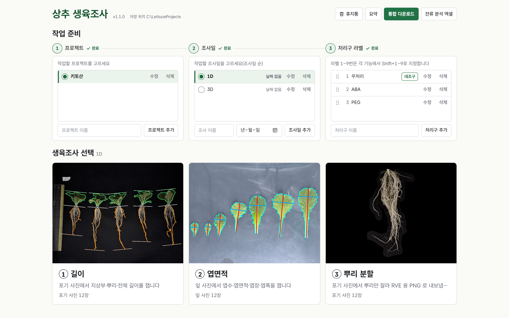
프로젝트 · 조사일 · 처리구 라벨을 만들고 할 일(1 길이 · 2 엽면적 · 3 뿌리 분할)을 고릅니다.
결과 엑셀은 오른쪽 위 [통합 다운로드] · [잔류 분석 엑셀] 로 받습니다.
### 1 길이
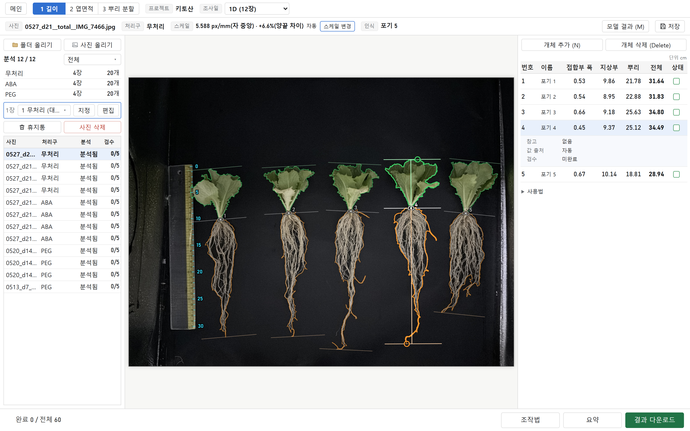
모델이 지상부(초록)와 뿌리(주황)를 나누고, 접합부 기준으로 지상부 · 뿌리 · 전체 길이와 접합부 폭을 잽니다.
틀린 점은 마우스로 끌거나 다시 찍어 고치고, Enter 로 완료합니다.

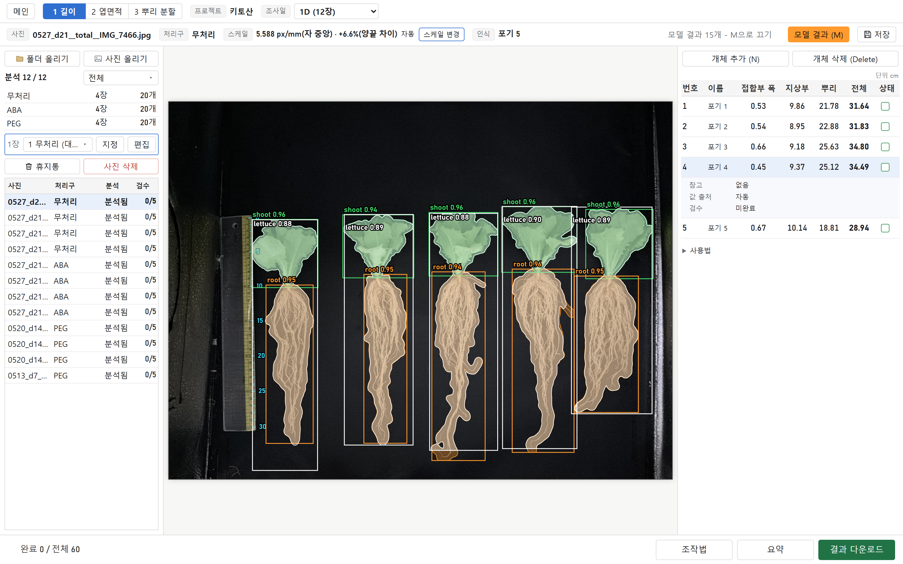
모델 결과(M) — 모델이 찾은 상추 · 지상부 · 뿌리 영역과 점수를 보여 줍니다.
### 2 엽면적
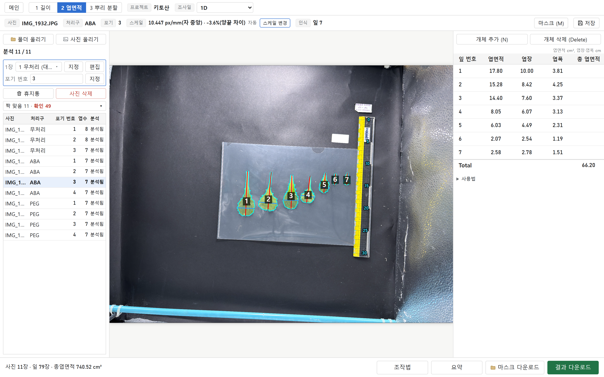
잎을 펼쳐 찍은 사진 1장 = 1포기. 잎마다 엽면적 · 엽장 · 엽폭과 엽수를 잽니다.
윤곽이 틀리면 더하기 · 빼기로 고칩니다.
### 3 뿌리 분할
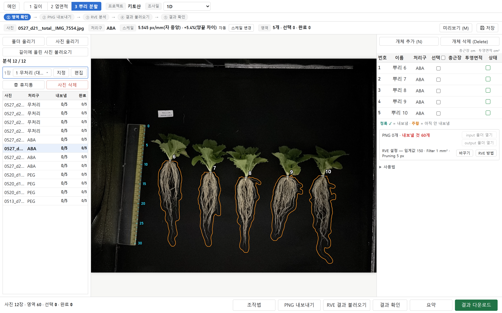
모델이 포기마다 접합부 아래 뿌리 영역을 자동으로 잡아 PNG 로 내보냅니다.
RhizoVision Explorer 로 총근장 · 투영면적을 분석하고, 영역을 고치면 고친 뿌리만 다시 내보냅니다.

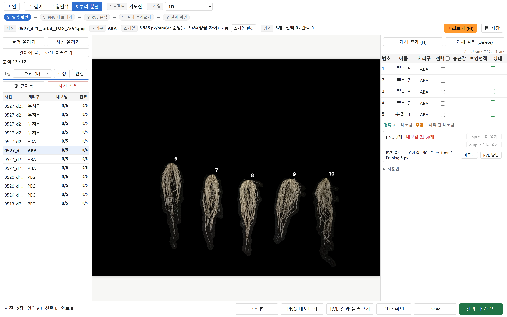
미리보기(M) — 내보낼 PNG 모습. 뿌리만 잘라 낸 그림입니다.
### 뿌리 분할 결과
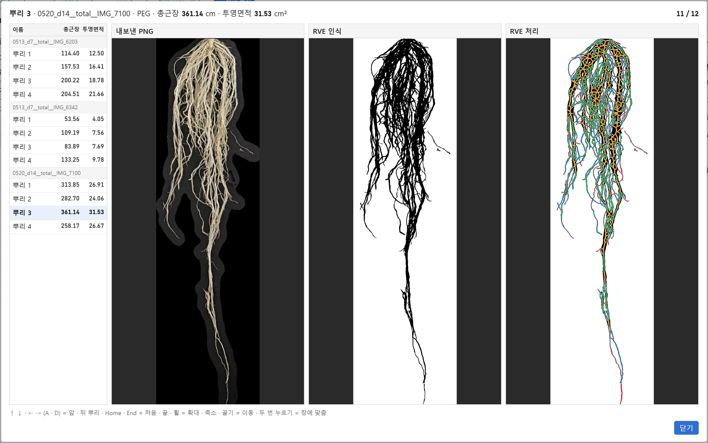
내보낸 PNG · RVE 인식 · RVE 처리 그림을 나란히 보며 뿌리마다 총근장 · 투영면적을 확인합니다.
### 조작법
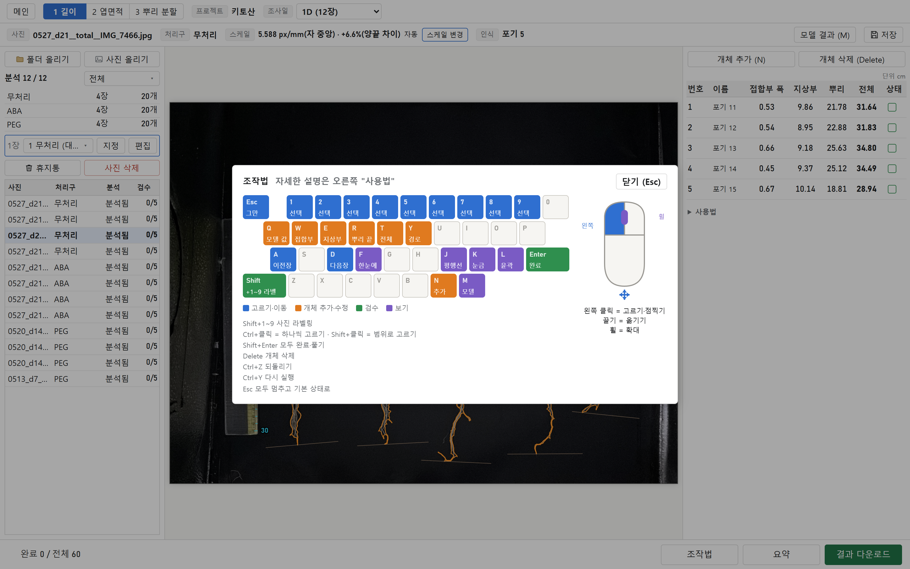
마우스 · 키보드 조작을 화면 안에서 바로 볼 수 있습니다.
### 요약
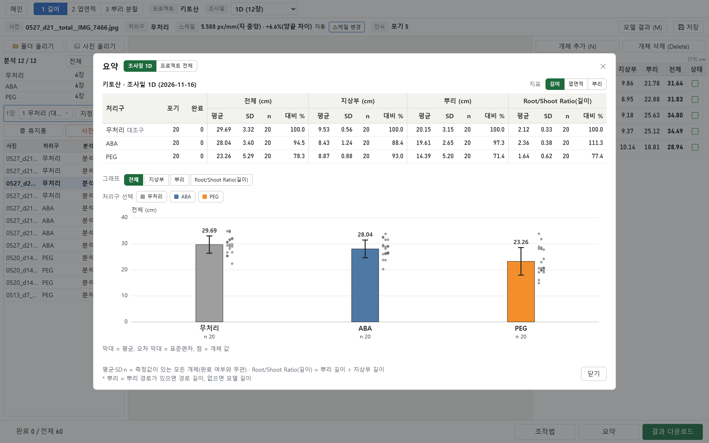
각 화면의 [요약] 으로 처리구별 결과를 표 · 그래프로 모아 봅니다. 그림은 1 길이 요약입니다.
### 통합 엑셀
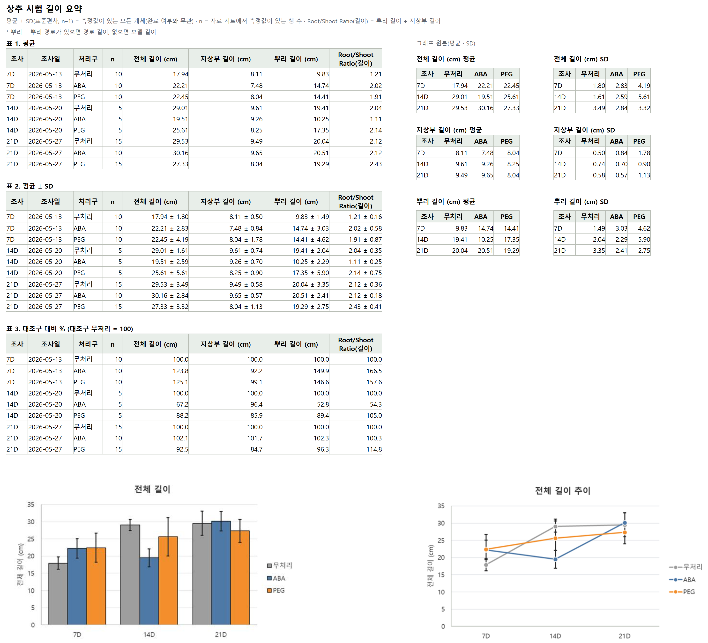
길이 · 엽면적 · 뿌리 결과를 조사일 × 처리구별 평균 · SD · 대조구 대비 % 표와 그래프로 한 파일에 받습니다.
### 잔류 분석 엑셀
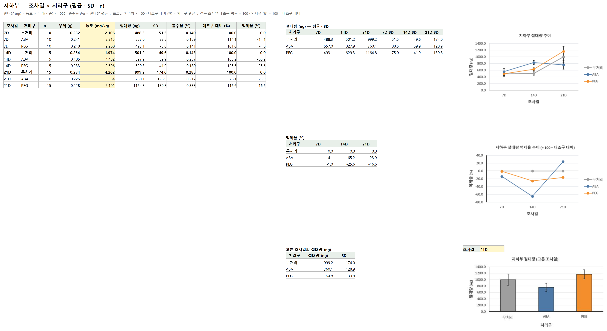
노란 칸에 무게 · 잔류농도를 넣으면 절대량 · 이행률 · 분포 비율 · 이행계수가 자동으로 계산됩니다.

## 함께 들어 있는 프로그램
- RhizoVision Explorer 2.0.3 (GPL-3.0) — Seethepalli A, Dhakal K, Griffiths M, Guo H, Freschet GT, York LM (2021) RhizoVision Explorer: open-source software for root image analysis and measurement standardization. *AoB PLANTS* 13(6): plab056. doi:10.1093/aobpla/plab056
